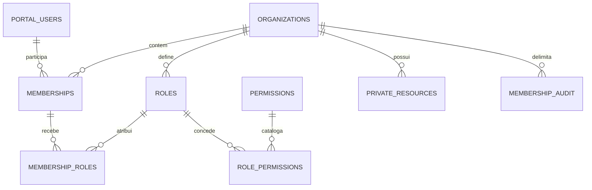

# F1-01-B-B-D06 — Contratos técnicos G-BB01 a G-BB08

**Data:** 06/11/2026, America/Sao_Paulo. **Entrega:** documentação técnica para revisão; nenhum gate homologado ou encerrado. **Autorização:** instrução específica D06 do responsável, exclusivamente documental. [Issue #17](https://github.com/rafhael100/imagine-portal/issues/17), [PR #19](https://github.com/rafhael100/imagine-portal/pull/19).

Este pacote detalha os requisitos já orientados pelas DEC-01–04. Não reabre alternativas A/B/C ratificadas nem cria rodada genérica de decisão. Recomendações novas de versão, parâmetros, capacidades e retenção são propostas concretas, não aprovações presumidas. Não contém SQL executável, migrations, funcionalidades ou configuração de infraestrutura.

## 1. Base factual e precedência

| Referência | Estado observado antes da edição |
|---|---|
| Git privado | Consulta autenticada de refs concluída com sucesso; rede permitida no sandbox; sem alterar credenciais/helpers |
| Desenvolvimento | `dev/fast-track-portal-2026-11-05` em `0aef6838b0452fcbb195fcad2e50aed748ec41c5` |
| Planejamento D01–D05 / DEC-01–04 | `docs/portal-f1-01-b-b-proposta-2026-11-06` em `75b32cef4afa0e7eae83e3b30fdc13c571a767d4` |
| PR #19 | Aberto, draft, não integrado; mantido sem edição/merge por D06 |
| PR #11 | Aberto, draft, não integrado; destino `main` |
| `main` | `50b683a499e674641df5749051f3d05f7ac3f627`; nenhuma escrita |
| D06 | Nova branch `docs/portal-f1-01-b-b-d06-gates-2026-11-06`, worktree isolada, derivada do SHA de desenvolvimento acima; PR novo para dev |

Trabalhos paralelos preservados: P02-A/B/C/D e SEC-P01 constam em dev. `DemoPortalSession` declara explicitamente que é fixture não confiável e não prova autenticação; o avaliador B-A continua puro, sem verificar proveniência ou revogação concorrente. D06 não transforma essas classes em mecanismo de segurança real. Nenhum arquivo existente foi substituído ou transportado da branch documental; referências são por SHA para não exigir merge do PR #19.

D01–D05 e DEC-01–04 foram lidos integralmente. As ratificações superam os avisos históricos “não aprovado” das tabelas D01–D04 somente quanto às diretrizes documentais A. D05 continua proposta. Permanecem abertos D02-SEC01..06, D03 físico/RLS, P0-DOC01..14 e homologação H/C/P. D06 distingue **contrato documentado**, **parecer/decisão pendente**, **evidência de execução ausente** e **autorização de programação ausente**.

## 2. G-BB01 — Baseline PostgreSQL e ambiente

**Requisitos funcionais/técnicos.** Persistência própria Portal, sem dependência do banco CRM; execução futura reprodutível de RLS, FKs e concorrência. Versão suportada, instalação rastreável, driver e biblioteca cliente identificados. Nenhuma conexão ou instalação é realizada nesta entrega.

**Arquitetura recomendada e justificativa.** Recomenda-se **PostgreSQL 17**, minor de segurança vigente na autorização do laboratório, fixada por versão e digest da imagem naquele momento. Tem suporte previsto até **08/11/2029**, oferece os mecanismos necessários e evita exigir recursos mais recentes para provar isolamento. PG18 é uma evolução possível, sem necessidade de suportar duas majors no primeiro recorte. Planejar revisão anual e upgrade homologado pelo menos seis meses antes do EOL; minor exige leitura de release notes, ensaio e restauração verificável, não promoção automática. [Política oficial PostgreSQL](https://www.postgresql.org/support/versioning/).

| Componente | Baseline candidata / evidência do repositório | Verificação futura exigida |
|---|---|---|
| Framework | Laravel `v13.40.0` no lock; requisito `^13.0` | Instalação pelo lock sem atualização incidental; testes PG na versão fixada |
| PHP | `^8.3`; CI atual em 8.3 e 8.4 | As duas versões com patches suportados na execução; conferir requisitos de todos os pacotes |
| Driver | PDO + `pdo_pgsql` + libpq fornecida pela imagem | Registrar versão/build de PHP, extensão e libpq, TLS e parâmetros de prepared statements |
| UUID | `ramsey/uuid 4.9.4` e `symfony/uid v7.4.21` já no lock | Sem dependência nova; geração proposta no servidor de aplicação, ver G-BB02 |
| Conexões | Inicialmente PDO não persistente direto; perfil adicional PgBouncer por transação | Homologar os dois caminhos antes de liberar pool em uso; statement pooling excluído |
| CI | Workflow PHP atual é sem banco; filtros não cobrem só `docs/` | Plano futuro separado para PG, sem mudar workflow neste PR; verde atual não prova RLS |

Laravel documenta suporte PostgreSQL, mas isso não comprova a combinação local de driver, pool e políticas. [Documentação Laravel 13](https://laravel.com/docs/13.x/database). `config/database.php` atual usa `search_path=public` e `sslmode=prefer`: são defaults do scaffold, não baseline de segurança aprovada. Futuro tráfego fora de ambiente descartável local deve verificar certificado/hostname e usar schemas protegidos; não copiar defaults para produção.

Topologia futura mínima: um banco PG descartável, aplicação/testes isolados, rede privada de laboratório, sem porta pública, volumes temporários, sem acesso a CRM/VPS e sem credenciais de produção. Credenciais efêmeras de laboratório somente sob futura autorização específica. Não criar serviços agora. Orçamento proposto sem nova contratação, usando recurso de CI já autorizado; disponibilidade/quota/custo não foram comprovados. Plataforma deve registrar limite antes de autorizar execução. Testes de falha usam duas ou mais conexões independentes, não um mock de SQLite.

**Decisões pontuais pendentes:** aceite PG17; minor/digest/OS e libpq exatos; versão fixada PgBouncer se incluída; quota de CI, executor e responsável de manutenção. Não é necessário escolher VPS nesta fase.

**Riscos/mitigações:** dependência transitiva incompatível → testar lock nos dois PHPs; versão flutuante → digest e manifesto; pool incompatível → perfil direto obrigatório e perfil pooled separado; EOL → revisão programada. **Dependências:** G-BB05/06/08; políticas de ambiente/backup de G-BB07.

**Homologação futura:** manifesto completo de versões/digests sem segredos; duas células PHP×PG17 aprovadas; instalação sem alteração do lock; driver efetivo e TLS conferidos; perfis direto e pooled identificados nos resultados. Dono proposto **Arquitetura/Plataforma**, revisão Backend/DBA. **Situação: DOCUMENTADO; versão/ambiente pendentes; execução bloqueada por falta de autorização.**

## 3. G-BB02 — Modelo físico, integridade e escopo

**Requisitos.** Uma membership canônica por par usuário/organização, grants somente por papéis locais, propriedade explícita e imutável da organização, autoria histórica, intervalos temporais e revisão. Nenhum tenant inferido por e-mail/CNPJ/ID CRM. Contratante e pagador continuam entidades futuras separadas; sem schema financeiro neste recorte.

**Arquitetura recomendada.** Schema lógico `portal_data` para dados privados, `portal_identity` para identidade mínima, `portal_authz` para catálogo/metadados internos e `portal_audit` para evidências; todos no banco exclusivamente Portal. Esses nomes organizam privilégios, não são schema por empresa. Recomenda-se **UUIDv4** gerado na aplicação por biblioteca já fixada: funciona sem extensão PG e não expõe timestamp de criação no ID. UUID não é segredo nem substitui autorização. UUIDv7 fica como otimização a justificar por medição, sem adiar a especificação atual.

Relações privadas no diagrama são implementáveis futuramente apenas com tenant na FK. A identidade é global **dentro do Portal**, não diretório global acessível aos clientes.

| Tabela proposta / escopo | Tipos/chaves mínimos | Integridade e índices candidatos |
|---|---|---|
| `portal_users` / global protegido | `id` UUID PK; `status` texto fechado; `authz_revision` bigint positivo; criação/alteração timestamptz | Sem FK CRM; índice PK; estado só active/suspended/revoked; nenhum segredo/campo de login neste modelo |
| `customer_organizations` / tenant raiz | `id` UUID PK; nome limitado; status; `authz_revision`; instantes; autor local | active/suspended/archived; PK; nomes não únicos; sem CNPJ como chave |
| `organization_memberships` / tenant | UUID PK; organização/usuário UUID; status; início/fim; revisão bigint; autoria | Par organização/usuário único inclusive após revogação; único organização/id; FK organização e FK usuário; índice usuário/organização para bootstrap; índice organização/status |
| `organization_roles` / tenant | UUID PK; organização; código limitado; estado; revisão | Únicos organização/id e organização/código; FK organização; role não concede por seu nome |
| `permissions` / catálogo global sem PII | Código texto PK; versão bigint; estado; descrição | Vocabulário fechado; sem wildcard; alteração só por processo técnico separado; sem hard delete que reinterprete código antigo |
| `role_permissions` / tenant | organização UUID; papel UUID; código de permissão; estado/validade/revisão; autoria | Chave organização/papel/código; FK composta para papel; FK para catálogo; linha canônica e evento a cada mudança |
| `membership_roles` / tenant | organização UUID; membership UUID; papel UUID; estado/validade/revisão; autoria | Chave tripla; FKs organização/membership e organização/papel; índice organização/papel para revogação de papel |
| `membership_audit` / tenant | UUID evento; organização; alvo/tipo; ator/origem; membership autorizadora quando houver; ação/resultado; revisões; correlação UUID; instante | FK contextual para alvo local quando aplicável; organização/instante e correlação indexados; append-only; manutenção de retenção separada |
| `private_resources` / fixture futura | UUID PK; organização UUID; referência fictícia; revisão; autoria | Único organização/id; FK composta entre recursos privados; imutabilidade de organização; não vira serviço real |

Tipos comuns: instantes timestamptz/UTC com precisão de microssegundos; revisões bigint não nulas e crescentes; vigência `[início,fim)`, fim opcional e estritamente posterior ao início. Relógio da autoridade PG; avaliar validade com instante atual após obtenção de locks, não com horário de início de transação que pode ficar obsoleto enquanto espera. Campos de escopo e estado sempre não nulos. Campos textuais têm limites explícitos no futuro dicionário DDL, sem payload livre de cliente no motivo. Índices B-tree acompanham FKs e acesso por tenant; não adicionar GIN/particionamento sem consulta demonstrada.

Toda FK entre tabelas privadas inclui organização; PK global UUID isolada não justifica FK privada simples. Relações com usuário/catálogo globais são exceções inventariadas e não concedem acesso por FK. `created_by_portal_user_id` é história, `authorized_membership_id` é mandato contextual; autoria não depende de membership continuar ativa. Proibir cascatas destrutivas em identidade, vínculos e auditoria; anonimização/expurgo só conforme G-BB07. Organização de recurso não muda por UPDATE/cópia; transferência é fluxo não autorizado.

**Decisões pendentes:** parecer Dados/Segurança sobre inventário, tipos e UUIDv4; limites de texto e constraint names no futuro DDL; cardinalidade/planos de consulta para tuning. Não falta escolher direção de schema/FK: DEC-01 já a definiu.

**Riscos/mitigações:** referência cruzada → FK composta + RLS; unicidade revela terceiro → pré-validação e erro genérico; perda de autoria → restrição de delete; duplicatas/reingresso → linha canônica e histórico. **Dependências:** G-BB03/04/05/07. **Homologação:** rejeitar FK cruzada, duplicidade concorrente, revisão regressiva, fim inválido e mudança de tenant sem mutação parcial; comprovar exceções globais e índices por catálogo de laboratório futuro. Dono **Dados/DBA**, revisão Segurança. **Situação: DOCUMENTADO; revisão física pendente; sem tabelas criadas.**

## 4. G-BB03 — Origem e cadeia de confiança

**Requisitos.** Origem Portal verificável para usuário, fonte oficial canônica para vínculo, política e recurso, nenhum objeto de cliente como autoridade. Bootstrap só revela empresas do próprio ator; falhas negam sem enumeração. Independência total de autenticação humana Portal/CRM, sem SSO, cookies ou banco compartilhado.

**Contrato recomendado e justificativa.** Fronteira de autenticação futura exclusivamente Portal fornece emissor local, ID local, revisão/estado atual e referência interna de autenticação verificada. Isso é um contrato sem token/protocolo/login implementado. Backend resolve por fonte local oficial, nunca pelo corpo/header enviado pelo usuário. Seleção de empresa é apenas intenção; fonte canônica resolve vínculo e grants; recurso é buscado sob empresa autorizada. Aplicação prepara contexto de transação só após validar origem, mas volta a verificar estados/revisões sob barreira antes do efeito.

| Entrada | Autoridade candidata | Regra em caso de ausência/contradição |
|---|---|---|
| Ator | Autenticador Portal futuro e registro local de usuário | Negar; `DemoPortalSession` nunca satisfaz esta fronteira |
| Empresas visíveis no bootstrap | Consulta privada por ator comprovado, retornando apenas ID/nome mínimo de memberships elegíveis | Não listar diretório; sem empresa padrão; sem dados de membros/recursos |
| Empresa selecionada | Solicitação validada contra o bootstrap e novamente contra vínculo oficial | Negar empresa ausente/suspensa; seleção antiga não prova grant |
| Membership | Par canônico usuário/organização, estado, validade e revisão da fonte primária | Negar duplicidade, convite, suspensão, expiração e revogação |
| Capacidades | Projeção unidirecional de papéis/grants ativos e catálogo reconhecido | Código estranho e fonte concorrente negam; nunca somar grants do cliente |
| Propriedade | Organização persistida no recurso e nas relações compostas | Recurso de outra empresa não é retornado nem autorizado |

Bootstrap não é um SELECT amplo com filtro opcional do front-end. Requer operação privada mínima cujo ator deriva da fronteira confiável e não argumento de livre escolha. A operação retorna só referências próprias elegíveis; vínculo suspenso/revogado não aparece para entrar no tenant. Recuperação não usa bypass dessa lista.

**Laboratório futuro:** fixture de autoridade local deve ser explicitamente identificada como simulada, injetada apenas pelo executor de testes, sem endpoint ou seletor público que aceite ator arbitrário. Dois usuários e duas empresas não bastam para provar independência: incluir caso de ID textual igual em origem CRM, referência adulterada e revisão antiga. Não transportar fixture para tráfego real.

**Limite de confiança a aceitar expressamente:** runtime íntegro verifica ator e usa conexão compartilhada. Configuração local PG transporta contexto, não o autentica contra runtime comprometido. RLS proposta impede omissão acidental de escopo, não garante isolamento diante de atacante com SQL arbitrário na credencial runtime. Usar queries parametrizadas e privilégios mínimos; caso o requisito seja resistência a runtime hostil, este desenho é insuficiente e exige autoridade/contexto independente antes de liberar uso real.

**Pendências:** Identidade/Segurança devem aprovar emissor e bootstrap descritos, a simulação do laboratório e o limite de ameaça; contrato real D02-SEC01 de autenticação/MFA/recuperação segue fora do laboratório. **Riscos/mitigações:** origem falsificada → resolução local; seleção adulterada → dupla validação; IDs iguais → origem independente; aplicação comprometida → limitação explícita e bloqueio de uso real sem revisão. **Dependências:** G-BB02/04/05/06. **Homologação:** negar todos os casos H02/C03/P01, sem empresas/atributos de terceiro; comprovar que fixture não expõe autenticador e bootstrap não aceita identidade arbitrária. Dono **Identidade/Backend**, revisão Segurança/Produto. **Situação: DOCUMENTADO; contrato de autoridade pendente; uso real BLOQUEADO.**

## 5. G-BB04 — Capacidades, alçadas e revogação

**Requisitos.** Catálogo fechado e versionado, política local, separação de gestão de membros, atribuição de papéis, definição de política e leitura de auditoria. Nenhum `owner` universal. Revogação atômica prevalece após commit. Reingresso e recuperação não reativam grants antigos.

**Recomendação de catálogo.** Manter vocabulário B-A como referência de compatibilidade, sem ampliar seus significados. Propor capacidades adicionais de administração separadas; a futura adaptação é outro trabalho autorizado. O laboratório pode restringir-se a `services.view` e uma alteração fictícia com `services.manage`, mais os controles de autorização testados, sem dados comerciais.

| Código proposto | Operação delimitada | Não concede |
|---|---|---|
| `services.view` | Ler recurso de serviço fictício da organização | Alterar, contratar ou ler outra empresa |
| `services.manage` | Alteração fictícia de recurso no laboratório | Contrato, cobrança, publicar site ou integração |
| `billing.view` | Leitura futura de resumo autorizado | Emitir cobrança, aceitar contrato ou administrar acesso |
| `members.view` | Lista mínima de membros no tenant | Perfil global/PII ou atribuir papel |
| `members.manage` | Suspender/revogar vínculo dentro da alçada | Editar política, atribuir papel ou reingressar revogado |
| `roles.assign` | Atribuir/retirar papel vigente a terceiro conforme matriz | Alterar definição ou aumentar própria alçada |
| `roles.define` | Manutenção controlada da definição local | Criar código de capacidade ou mudar outro tenant |
| `audit.view` | Consultar eventos minimizados do tenant | Exportar todos os logs, alterar/apagar evidência |

Papéis iniciais propostos: `member` somente `services.view`; `manager` com `services.view`, `services.manage`, `members.view`; `owner` acrescenta gestão de vínculos, atribuição de papéis e auditoria **somente quando explicitamente atribuídas na política local**. `billing.view` é opcional e independente, sem concedê-la automaticamente por título. `roles.define` permanece desabilitada na primeira experiência; definição de política só pelo processo técnico aprovado do laboratório, não função de staff real. Nomes B-A continuam descritivos até autorização de qualquer adaptação.

| Ação | Concedente / condições propostas | Bloqueios |
|---|---|---|
| Atribuir/retirar papel | Vínculo ativo com `roles.assign`; alvo terceiro no mesmo tenant; conjunto de capacidades do papel contido no mandato atual do concedente | Autoatribuição/autoelevação, grant direto, papel de outra empresa ou revisão antiga |
| Suspender/revogar membro | `members.manage` + mandato suficiente sobre as capacidades atuais do alvo; motivo e evento | Não remover último gestor recuperável; alvo com poderes superiores exige autoridade adequada |
| Alterar política local | Processo segregado autorizado, revisão comparada e impacto em todos os membros | Sem editor genérico runtime; nenhuma alteração do catálogo global pelo cliente |
| Retomar suspenso | Nova decisão por concedente autorizado e revalidação completa | Sem retorno automático; política vigente, não fotografia de grants antigos |
| Reingresso revogado | Bloqueado no primeiro recorte | Requer contrato B-C separado de aceite, identidade/alçada e novos grants |
| Recuperar último gestor | Procedimento humano segregado, dois responsáveis e prova de titularidade a especificar | Sem endpoint de suporte/impersonação ou staff global; indisponibilidade segura até autorização |

Contar “último gestor” por capacidade efetiva de administrar vínculos e atribuir papéis, ativa e vigente, não por nome owner. Sob a mesma barreira de organização, reavaliar efeito da mudança antes de commit; duas remoções simultâneas não podem deixar zero. Expiração futura de todos os gestores exige alerta/procedimento, sem prorrogar grants automaticamente. Staff/delegação/contas técnicas permanecem sem acesso implícito.

Revogação de usuário bloqueia todas suas memberships Portal; organização inativa bloqueia seu conjunto; papel/grant/vínculo revogado retira apenas o escopo correspondente. Incrementar revisão relevante e registrar evento atômico; não reutilizar grants de cache, jobs, sessão ou réplica. Falha do evento obrigatório aborta a mudança. Tentativa negada é evento distinto de mudança concluída, com destino minimizado e sem alegar sucesso se a transação foi revertida.

**Pendências concretas:** Produto/Segurança validarem códigos, atribuições e matriz; nomear dois responsáveis para recuperação; aprovar regra de suspensão/último gestor. Para laboratório, reingresso, recuperação, contratos e delegação ficam explicitamente bloqueados, sem impedir testar a negação desses fluxos. **Riscos/mitigações:** autoelevação → comparação de mandato efetivo; corrida do último gestor → serialização por organização; grants antigos → revisão/barreira G-BB06; auditoria falsa → atômica e eventos distintos. **Dependências:** G-BB02/03/05/06/07. **Homologação:** projeção igual ao conjunto efetivo esperado; negações C01/C02/P03/P05; duas remoções concorrentes deixam gestor ou negam; falha de auditoria não altera grant. Dono **Produto + Segurança**, algoritmo revisado por Dados. **Situação: DOCUMENTADO; matriz/alçadas pendentes; reingresso e recuperação BLOQUEADOS.**

## 6. G-BB05 — RLS e segregação de privilégios

**Requisitos.** Inventário completo das relações privadas e exceções globais; regras para todos os comandos; privilégio runtime mínimo; nenhum caminho indireto amplo; avaliador privado sem recursão/oracle. RLS é segunda barreira e nunca substitui identidade, FK ou alçada.

**Arquitetura recomendada.** Owner DDL distinto do runtime; avaliador mínimo consultando metadados privados de autorização; política tenant restritiva combinada com permissões explícitas por comando. Uma política restritiva sozinha não concede acesso: é necessário o conjunto permissivo mínimo do comando, sempre limitado pela barreira restritiva. Revisar a composição efetiva, não cada política isoladamente.

| Role conceitual | Permissão necessária | Proibições / exposição |
|---|---|---|
| Owner de schema/tabelas, sem login | DDL sob executor aprovado e temporário | Não pertence ao runtime, não atende requisições |
| Executor de laboratório/migrations futuro | Acesso DDL somente no laboratório autorizado | Separado do teste runtime; credencial nunca na aplicação |
| Runtime | Leitura/escrita do recurso fictício conforme ação/RLS; chamadas internas estritamente necessárias | Sem owner, superuser, BYPASSRLS, herança/assunção de role privilegiada, DDL, TRUNCATE, replicação, criação em schema de busca ou extensão |
| Owner do avaliador, sem login | Ler só metadados de autorização necessários | Sem BYPASSRLS genérico, sem DDL/retorno de PII, não compartilhado com owner dos recursos |
| Escritor de auditoria controlado | Inserir evento validado ligado à transação | Sem update/delete ou leitura ampla por cliente |
| Leitor de auditoria | Eventos minimizados com `audit.view` e escopo tenant | Sem logs globais ou exportação irrestrita |
| Operador de retenção/restore | Acesso operacional separado e autorizado por finalidade | Não utilizado no runtime nem para “corrigir” permissões manualmente |

Recomendação concreta para evitar recursão: metadados de elegibilidade ficam em schema privado sem SELECT/DML direto pelo runtime; o owner sem login do avaliador recebe leitura estreita desses metadados. RLS das tabelas expostas consulta o avaliador; políticas dos metadados privados autorizam apenas esse leitor técnico mínimo, sem voltar a chamar o avaliador. Alterações de metadados só por operações controladas que validam tenant/alçada e participam da barreira. Revisar grafo de dependências para comprovar que nenhum caminho retorna à policy de origem. Não criar projeção paralela de grants como segunda fonte de verdade.

Avaliador retorna booleano apenas para a capacidade reconhecida e contexto corrente; não aceita alvo/empresa arbitrários, não retorna atributos ou distingue inexistência de terceiro. Se envolver execução com privilégios elevados: assinatura fixa, nomes qualificados, caminho de busca fixo com somente schemas confiáveis, ausência de SQL dinâmico, EXECUTE sem acesso público indiscriminado; temp/public não resolvem objetos do avaliador. Não registrar função como `leakproof` ou cacheável imutável por conveniência. Identidade do contexto continua sujeita ao limite G-BB03. Esse desenho necessita parecer independente, não é função aprovada por esta documentação.

| Relação / comando | Política candidata em linguagem natural |
|---|---|
| Recurso privado: leitura | Empresa da linha = contexto; usuário/empresa/vínculo/grant ativos e vigentes; capacidade de leitura reconhecida |
| Recurso: inserção | Mesmo escopo na linha nova; autoria do servidor; relações compostas; capacidade específica |
| Recurso: alteração | Elegibilidade sobre linha antiga **e** nova; tenant e autoria histórica imutáveis; revisão esperada; efeito sob barreira |
| Recurso: exclusão | Negada no laboratório inicial; cenários negativos comprovam falta de privilégio/policy |
| Organização | Selecionada e elegível apenas; bootstrap independente retorna referência mínima própria, sem ler recursos |
| Membership/papéis/atribuições | Leitura mínima controlada por capacidades; sem DML genérico; alteração por operação aprovada, nunca por payload de grants |
| Usuário global | Próprio perfil mínimo via autoridade local; sem diretório; consulta de elegibilidade não expõe PII |
| Catálogo | Leitura técnica sem PII; cliente/runtime não altera versão/códigos |
| Auditoria | Tenant + capacidade específica; escrita controlada; atualização/exclusão negadas ao runtime |

RLS deve estar habilitada nas tabelas privadas expostas e considerada forçada para owner quando aplicável. Superuser/BYPASSRLS continuam contornando RLS; `FORCE` não os neutraliza. Tabelas/índices/constraints podem produzir erros que revelam existência: normalizar erro externo sem ocultar falha técnica do revisor. Inventariar views invoker/owner, funções, triggers, partições/consulta direta, COPY/export, heranças e roles indiretas; nenhum caminho dispensado. [Semântica oficial RLS PG17](https://www.postgresql.org/docs/17/ddl-rowsecurity.html).

**Pendências:** revisão independente de roles/grants, grafo sem recursão e ameaça de runtime; validar assinatura/owner do avaliador e mecanismo controlado de mudança. **Riscos/mitigações:** OR amplo → composição restritiva; função privilegiada → menor assinatura/grants; busca adulterada → schemas protegidos; owner/bypass → credenciais distintas e testes reais por role. **Dependências:** G-BB02/03/04/06/08. **Homologação:** catálogo de grants prova todas as proibições, runtime nega H05/H06/C06/C07/P06/P08; ausência de linhas, efeitos e atributos de terceiros inclusive por caminhos indiretos. Dono **DBA**, revisão independente **Segurança**. **Situação: DOCUMENTADO; revisão de privilégios/avaliador pendente; implementação BLOQUEADA.**

## 7. G-BB06 — Unidade transacional, pooling e falhas

**Requisitos.** Contexto local somente na mesma transação/conexão; nenhum resíduo entre atores; ação sensível e revogação têm ponto de ordenação comum; retries revalidam tudo; perda de conexão não prova rollback nem autoriza repetição cega.

**Algoritmo candidato em descrição, sem SQL.** Usar `READ COMMITTED`, transação explícita no primário, PDO não persistente no primeiro perfil. Antes de ler dado privado, resolver identidade confiável, configurar contexto local e obter barreiras necessárias. Ordem fixa: usuários envolvidos ordenados por UUID → organizações envolvidas ordenadas por UUID → vínculos ordenados → papéis/atribuições ordenados → recurso. Para uma ação comum, bloquear usuário e organização; lock exclusivo da linha de organização serializa ações sensíveis, mudanças de política, grants e último gestor na primeira experiência. É deliberadamente conservador e mensurável, sem otimização prematura. Nunca adquirir usuário depois de organização; identificar conjunto de atores antes e reler vínculo dentro da barreira.

A obtenção de locks exige privilégios próprios no PostgreSQL: não conceder UPDATE genérico de usuário/organização ao runtime apenas para viabilizar a barreira. Recomenda-se operação interna estreita, revisada no G-BB05, que bloqueie somente as referências do contexto validado, na mesma conexão/transação e sem devolver dados ou aceitar tenant arbitrário. O parecer DBA deve verificar sua assinatura, grants e interação com RLS.

Revogação global de usuário obtém barreira do usuário, incrementa revisão e audita; todas as ações usam essa barreira antes da organizacional. Revogação organizacional/papel/grant usa barreira da organização, além das identidades pertinentes. Nova verificação após obtenção de locks lê estado/revisões atuais e instante de validade atual; só então decide, grava efeito e evento obrigatório no mesmo commit. Se ação obtém barreira primeiro, revogação espera seu término; se revogação conclui primeiro, ação posterior nega. Duração do lock é limitada pelos timeouts. Isso serializa efeitos locais; não faz promessa sobre efeitos externos, que estão excluídos.

Contexto contém usuário Portal, organização, correlação e revisões verificadas; `SET LOCAL` é apenas o mecanismo descrito de transporte. O primeiro contexto não deve ser usado como prova definitiva antes da revalidação; o mecanismo final e avaliador devem tolerar apenas a revisão validada e negar divergência. Não aceitar leitura privada automática antes dessa sequência, reconexão silenciosa ou read/write splitting.

Parâmetros **candidatos de laboratório**, a revisar por medição: espera de lock 1 s, statement 3 s, transação ociosa 5 s, deadline de unidade 10 s; no máximo 3 tentativas totais para deadlock/conflito retryable, dentro do deadline e com backoff curto. Esperar expiração pode alterar validade: checar o instante novamente antes do efeito. Não prometer throughput ou SLO de produção com esses números.

| Ocorrência | Comportamento obrigatório futuro |
|---|---|
| Commit confirmado | Encerrar contexto; nova transação começa sem ator/tenant herdado |
| Exceção/erro, lock timeout ou statement cancelado | Rollback integral; nenhum efeito/auditoria de sucesso; descartar conexão se estado for incerto |
| Rollback a savepoint | Não supor contexto/barreira intactos; unidade de autorização falha por inteiro no primeiro recorte |
| Deadlock/conflito retryable | Nova transação, contexto e revisão; nunca reutilizar `allow`; máximo/deadline aplicáveis |
| Falha de rede antes/durante commit | Resultado inconclusivo; consultar marcador idempotente no primário em transação nova; não repetir cegamente |
| Replay da mesma operação | ID idempotente escopado a tenant/ator/ação; fingerprint do comando; resultado distinto com mesma chave gera conflito, não outro efeito |
| Troca de tenant/worker | Encerrar unidade, descartar objetos/permissões anteriores e começar contexto independente |
| Réplica/cache/job | Não autorizar por réplica/cache; job leva referências, não grant; revalidar no primário antes da unidade |
| Exportação longa | Por lotes com revalidação/barreira; revogação impede próxima unidade; bytes já entregues não são revogáveis |

Para idempotência de escritas fictícias propõe-se marcador privado `authorization_operations`: organização, UUID de operação, ator, ação, fingerprint sem payload sensível, estado/resultado mínimo e correlação, chave única organização/operação. Sua gravação e efeito são atômicos, com RLS e retenção própria G-BB07. É tabela auxiliar proposta em complemento ao inventário G-BB02, não implementada. Consultar resultado de operação já feita não autoriza novo efeito nem libera resposta privada sem autorização atual. Se marcador não puder esclarecer um commit perdido, bloquear repetição e escalar.

Pooling: perfil direto é baseline de comparação; perfil PgBouncer usa transaction pooling, mesma conexão backend durante toda a transação. Statement pooling incompatível. Não depender de SET de sessão, temp table persistente, advisory lock de sessão ou cursor que sobreviva ao commit. Prepared statements em protocolo dependem de versão/configuração do pooler; no laboratório inicial propor desabilitar prepares nomeados reutilizados e documentar opção PDO escolhida, depois testar explicitamente se habilitados. Não modificar configuração agora. [Mapa de compatibilidade PgBouncer](https://www.pgbouncer.org/features.html).

**Pendências:** DBA/Backend aprovarem algoritmo conservador, conjunto exato de locks, operação idempotente e timeouts; Plataforma fixar pooler/configuração antes de homologar perfil pooled. **Riscos/mitigações:** gargalo organizacional → medir antes de granularizar; deadlock → ordem única em todos os caminhos; TOCTOU → reler após barreira; commit perdido → marcador/consulta; contexto residual → rollback/descarte e teste de reuso. **Dependências:** G-BB01/02/03/04/05/07/08. **Homologação:** duas ordens de corrida coordenadas comprovadas sem sleeps como única sincronização; nenhuma ação com grant antigo após commit de revogação; reuso após todas as falhas sem resíduo; replay sem duplicidade. Dono **Backend/Dados**, revisão Plataforma/DBA/Segurança. **Situação: DOCUMENTADO; algoritmo e parâmetros pendentes; ensaios NÃO EXECUTADOS.**

## 8. G-BB07 — LGPD, evidências e recuperação

**Requisitos.** Minimização por finalidade, acesso segregado, trilha de quem alterou concessões, retenção limitada e restauração que não ressuscite grants. Nenhum dado real, segredo ou credencial no Git, teste ou log. D06 não define base legal ou prazo de obrigação contratual por inferência.

**Arquitetura recomendada.** Separar auditoria tenant, diagnóstico operacional, prova de revisão e marcador de idempotência. Evento mínimo de concessão/revogação: UUID, origem tipada Portal, ator opaco, organização/alvo, ação, resultado, motivo codificado, revisões antes/depois, instante e correlação. Escrita atômica com mudança; consulta por `audit.view`; append-only para runtime. ID opaco ainda pode ser dado pessoal por correlação, portanto não equivale a anonimização. Negative audit não inclui payload e não atribui como fato empresa/ator não comprovados.

| Classe / finalidade | Retenção proposta e marco | Acesso/descarte e pendência objetiva |
|---|---|---|
| Fixture/laboratório | Até término da execução; logs sanitizados de QA por 30 dias após resultado final, proposta técnica | Sem PII; apagar volumes ao final; QA/Segurança validam prazo e armazenamento |
| Diagnóstico operacional futuro | Proposta 14 dias após evento, sem renovação por consulta | Só operação autorizada; sem tokens, IP ou user-agent por padrão; Privacidade deve validar necessidade/prazo |
| Negativas de autorização futuras | Proposta 30 dias após tentativa, agregação minimizada quando suficiente | Segurança por incidente; antiabuso com limite de volume; legal hold apenas fundamentado |
| Mudança de vínculo/política | Prazo final **pendente** de finalidade/base legal/necessidade de contestação | Sem assumir perpetuidade ou os 90 dias de leads; Privacidade/Produto devem registrar prazo e evento inicial antes de uso real |
| Perfil/identidade revogada | Sem exclusão em cascata; minimização/anonimização após obrigações aplicáveis | Prazo e campos a preservar pendentes; manter autoria por referência protegida quando necessário |
| Marcador idempotente | Horizonte de replay deve ser menor ou igual ao prazo de guarda do marcador | Proposta de laboratório: somente duração do ensaio; produção bloqueada até fixar ambos e impedir replay após expurgo |
| Backups de identidade/autorização | Política/RPO/RTO e prazo de guarda pendentes antes de uso real | Separados de CRM e dos leads; criptografia/acesso/expurgo e holds documentados por Plataforma/Privacidade |

Prazos numéricos acima são recomendações técnicas para revisão, não retenções legalmente aprovadas; não inventar prazo para contratos/auditoria sensível. A coleta real fica bloqueada enquanto faltar base/finalidade, termo inicial, prazo, acesso e procedimento de eliminação. Laboratório só utiliza dados comprovadamente fictícios e pode ter política de descarte distinta.

Segredos proibidos: senha/hash, sessão/token, chave de API, conteúdo de contrato/anexo/lead, CPF/CNPJ/e-mail real; não copiar ambiente de cliente. Correlacionar por IDs fictícios em testes. Provas de QA registram contagem, revisão e resultado mínimo; não extrair registros completos para “comprovar” negação. Exports e acesso a auditoria geram correlação e alçada própria.

Restauração futura: manter serviço fechado → restaurar em rede isolada → validar versão/schema/RLS/roles → reconciliar revogações posteriores ao snapshot com fonte durável independente → validar revisão/idempotência → executar testes negativos → colher aceite antes de reabrir. Recomenda-se cópia protegida dos eventos de revogação fora do domínio de falha do backup primário, com retenção pelo menos igual à janela de backups recuperáveis, mecanismo/custo a definir. Se não houver fonte confiável para reconciliar, invalidar todos os acessos restaurados e exigir revalidação controlada; nunca supor que backup antigo prova grant vigente. Não reabrir nem reativar rollback automático AGI-11-RB01.

**Pendências:** Privacidade/Encarregado validar finalidades, bases aplicáveis, prazos e anonimização; Plataforma definir backup/restauração, fonte de reconciliação, RPO/RTO e custos; nomear aprovadores. **Riscos/mitigações:** log vira base paralela de PII → campos mínimos; retenção indefinida → tabela por finalidade; restore revive privilégio → quarentena e reconciliação; falha da trilha → abortar concessão e manter evidência de falha separada. **Dependências:** G-BB02/04/06/08. **Homologação:** provar ausência de segredo/PII, isolamento de auditoria e falha atômica; ensaio de restore com revogação posterior ao snapshot impede acesso até reconciliação; expurgo obedece prazo sem reset por leitura. Dono **Privacidade/Encarregado + Segurança**, execução futura por Plataforma/Dados. **Situação: DOCUMENTADO; retenção/recuperação PENDENTES; coleta real BLOQUEADA.**

## 9. G-BB08 — Homologação rastreável e autorização

**Requisitos.** Cobertura individual de H01–H12, C01–C10 e P01–P12, testes positivos de controle e negativos com ausência de efeito e vazamento; execução sob role runtime, não só owner/mocks; revisão independente. Todos os 34 cenários continuam **NÃO EXECUTADOS** nesta entrega.

**Arquitetura do plano.** Duas empresas fictícias X/Y; usuários A/B, A com vínculos distintos e B somente em Y; usuário de origem CRM com mesmo texto local; papéis com permissões diferentes, states/validade/revisões variáveis; um recurso em cada empresa. Não permitir todos os testes “passarem” apenas porque a aplicação nega tudo: controle positivo conhecido precisa acessar X quando autorizado. Usar driver/PG reais do laboratório autorizado, primário, conexões distintas e perfil pooled quando aplicável. Fixtures e harness permanecem apenas especificados, sem arquivos executáveis.

Cada ensaio terá ID, SHA/versões/role/pool, pré-condição, ação, resultado esperado, checagem de linhas/efeitos/revisões/auditoria e prova sanitizada. E1 = manifesto e inventário de grants/policies; E2 = relatório de linhas/efeitos e asserções; E3 = ordem transacional coordenada com correlações; E4 = inspeção de logs/restore. Arquivos de evidência futuros serão nomeados pelo ID e vinculados ao SHA do código, sem credenciais. A tabela seguinte liga cenários anteriores sem renumerá-los.

| Ensaio original | Pré-condição/ação futura | Resultado objetivo / prova | Dono proposto |
|---|---|---|---|
| H01 | A em X solicita X e depois recurso X sob Y | Positivo só em X; nenhum dado/efeito cruzado; E2 | QA/Backend |
| H02 | Origem ausente/CRM, actor/grants adulterados | Negar sem atributos de terceiros; E2 | Identidade/Segurança |
| H03 | Usuário/empresa/vínculo não ativo ou fim da validade | Negar inclusive no limite exato; E2 com relógio controlado | QA |
| H04 | FK cruzada, par duplicado concorrente, mudança de tenant | Rejeitar e preservar estado anterior; E1/E2/E3 | Dados |
| H05 | Runtime tenta leitura/escritas sem filtro e sem contexto | Só linhas autorizadas; INSERT/UPDATE/DELETE indevidos sem efeito; E1/E2 | DBA/QA |
| H06 | Role indireta/owner/função/view/partição/OR tenta ampliar escopo | Runtime sem rota de bypass; teste de owner isolado prova limite conhecido; E1/E2 | Segurança/DBA |
| H07 | Reusar mesma conexão X→Y após sucesso/erro/rollback/timeout/retry | Nenhum contexto anterior; E2/E3 nos dois perfis | Plataforma |
| H08 | Corrida entre uso, revogação e mudança de política | Ordem pelas barreiras; nenhum efeito posterior com grant antigo; E3 | Dados/Segurança |
| H09 | Grant antigo em cache/réplica/job/export | Revalidar no primário, negar próxima unidade; E2/E3 | Backend |
| H10 | Staff sem mandato, autoelevação, remoção de último gestor | Negar sem efeito; recuperação não vira bypass; E2/E3 | Produto/Segurança |
| H11 | Falha de evento obrigatório e tentativa de log com PII/segredo fictício marcado | Mudança aborta; marcador sensível ausente do log; E2/E4 | Privacidade/QA |
| H12 | Restore antigo e versão de aplicação incompatível | Serviço fechado até reconciliar/revalidar; E4 | Plataforma/Dados |
| C01 | Papel sem grant, suspenso/revogado e projeção B-A | Conjunto efetivo exato, nunca grant implícito; E2 | Backend |
| C02 | Conceder acima do mandato/a si e retirar último gestor | Negação + estado preservado e trilha mínima; E2/E3 | Produto/QA |
| C03 | Origem CRM com mesmo ID/e-mail/CNPJ fictício | Nenhuma equivalência de identidade ou vínculo; E2 | Identidade |
| C04 | Ação primeiro; repetir com revogação primeiro | Ação conclui antes da revogação ou nega; E3 | Dados |
| C05 | Leitura stale em sessão/job/cache/réplica | Não produzir novo efeito com revisão antiga; E2/E3 | Backend |
| C06 | Runtime sem contexto ou com tenant não autorizado nos quatro comandos | Negação/zero linhas e zero efeitos cruzados; E1/E2 | DBA |
| C07 | Dependência RLS cíclica e função com privilégio excessivo | Revisão detecta ciclo/excesso e bloqueia desenho; nenhum oracle; E1/E2 | Segurança/DBA |
| C08 | Pool direto e por transação com todas as saídas | Contexto e conexão corretos por unidade; E3 | Plataforma |
| C09 | Runtime tenta DDL/TRUNCATE/desativar RLS e restore antigo | Privilégio negado; recuperação bloqueada até reconciliação; E1/E4 | DBA |
| C10 | Cliente lê trilha alheia; falha escrita de auditoria | Nenhum vazamento; grant/revogação aborta integralmente; E2/E4 | Segurança |
| P01 | Empresa sem vínculo, membership alheia, ID CRM equivalente | Negação genérica e nenhum recurso descoberto; E2 | Identidade/QA |
| P02 | Par duplicado e FK tenant inválida | Uma linha canônica ou conflito sem alteração parcial; E2/E3 | Dados |
| P03 | Concessão a terceiro além da alçada e autoelevação | Sem grant criado, revisões inalteradas salvo evento de tentativa; E2 | Produto/QA |
| P04 | Revogação e efeito sensível em duas conexões | Mesma ordem C04, sem depender apenas de sleeps; E3 | Dados |
| P05 | Concessões simultâneas, revisão antiga e reativação | Sem duplicidade; revisão antiga/reingresso bloqueados; E2/E3 | Backend |
| P06 | Runtime executa quatro comandos cruzados com/sem filtro | Sem efeito/linha privada de terceiro; E1/E2 | DBA/QA |
| P07 | Contexto ausente, rollback/savepoint/timeout e reuso | Unidade abortada ou contexto novo, sem herança; E3 | Plataforma |
| P08 | View/função/trigger/partição tenta rota privilegiada | Sem bypass/oracle; inventário cobre todos os caminhos; E1/E2 | Segurança/DBA |
| P09 | Job/cache/export com grant revogado | Próxima unidade negada/cancelada; bytes prévios não prometidos como recuperáveis; E2/E3 | Backend |
| P10 | Auditoria obrigatória indisponível | Nenhuma mudança de grant/revisão confirmada; E2 | QA |
| P11 | Backup antes de revogação é restaurado | Não reabre até reconciliar ou invalidar acessos; E4 | Plataforma |
| P12 | PII marcada, staff/conta técnica e último gestor | Log minimizado, acesso implícito negado, recuperação bloqueada; E2/E4 | Privacidade/Produto |

Complementos necessários dentro das mesmas famílias: commit com resposta perdida e replay (H08/H09, C04/C05, P04/P09), lock timeout/deadlock esgotando tentativas (H07/H08, C08, P07), expiração enquanto aguarda lock (H03/H08), duas remoções simultâneas de gestores (H10/C02/P05). Não criar nova rodada genérica de gates para esses detalhes.

**Critério objetivo de aprovação futura:** 34 IDs com resultado conclusivo no perfil aplicável; controles positivos aprovados; zero vazamento/efeito não autorizado; zero falha crítica/alta de identidade, tenant, revogação, RLS ou auditoria; resultados sob runtime e versões fixadas; repetição coordenada das duas ordens de corrida e teste de falhas. Caso não aplicável precisa justificativa específica e aceite Segurança/DBA, nunca omissão silenciosa. Perfil pooled não testado fica bloqueado, não é aprovado pelo perfil direto. Falha ou evidência inconclusiva mantém gate aberto.

**Pendências:** nomear QA, DBA e revisor de Segurança independentes do autor; aprovar ambiente/custos e critérios antes de pedir código; somente depois, sob autorização nova, produzir harness e evidências. **Riscos/mitigações:** falso positivo por owner → testar runtime e inventariar role; mocks ocultam comportamento PG → laboratório real isolado; testes que só retornam erro → checar estado e ausência de vazamento; CI verde genérico → relatório por ID/SHA. **Dependências:** todos os G-BB01–07. Dono **QA**, aprovação técnica proposta **Segurança + DBA**, autorização de promoção pelo responsável do projeto. **Situação: DOCUMENTADO; responsáveis e execução PENDENTES; homologação NÃO REALIZADA.**

## 10. Matriz geral para solicitar programação controlada

| Gate | Contrato entregue por D06 | Falta antes de solicitar laboratório | Prova posterior, só após autorização | Situação final |
|---|---|---|---|---|
| G-BB01 | PG17, PHP/driver/lock, topologia e perfis | Aceite versão; minor/digests/libpq/pooler; quota/custo e mantenedor | Manifesto e testes dos perfis escolhidos | Documentado; pendente |
| G-BB02 | ERD, UUIDv4, tabelas/FKs/índices e marcador auxiliar | Revisão Dados/Segurança e limites finais do dicionário | Constraints/FKs e unicidade concorrente | Documentado; pendente |
| G-BB03 | Cadeia de autoridade e bootstrap, fronteira simulada/real | Parecer Identidade/Segurança sobre emissor, simulação e ameaça runtime | Origem/tenant forjados negados; login real continua outro gate | Documentado; uso real bloqueado |
| G-BB04 | Catálogo, matriz concedente→alvo, ciclo e último gestor | Validar capacidades/mandato e nomear donos da recuperação; exclusões do laboratório | Projeção, autoelevação e concorrência de grants/gestores | Documentado; reingresso/recuperação bloqueados |
| G-BB05 | Roles mínimas, políticas por comando e grafo candidato | Parecer independente de privilégios, avaliador e bypass | Inspeção de catálogo + negativas por runtime/caminhos indiretos | Documentado; revisão pendente |
| G-BB06 | Barreira, ordem de locks, isolamento, idempotência e falhas | Aceite do algoritmo/limites e perfil de pool | Corridas/replays/falhas com provas E3 | Documentado; ensaios pendentes |
| G-BB07 | Matriz de finalidade, prazos propostos, restore seguro | Aceitar retenção de fixtures/provas; registrar exclusão de dados reais | Descarte/restore sintético; política real segue bloqueada | Documentado; retenção/restore pendentes |
| G-BB08 | 34 cenários rastreados, provas, donos e critério | Nomear pessoas/revisores; aceitar escopo e critérios conclusivos | Relatório por ID e parecer independente | Documentado; não homologado |

**Pedido futuro mínimo, ainda não autorizado:** laboratório descartável de persistência com duas empresas, identidades exclusivamente fictícias, um recurso privado, catálogo limitado, RLS/runtime, revogação e reuso de conexão; sem rotas, login/MFA, convite, contrato, API externa ou UI real. A autoridade simulada é contrato explícito e não homologação do autenticador Portal. Gates de produção podem permanecer abertos se forem excluídos nominalmente desse recorte e se a revisão técnica aceitar que a exclusão não esvazia os testes de isolamento.

Antes do pedido, consolidar no mesmo pacote os pareceres específicos acima, responsáveis nomeados, SHA base atualizado, arquivos permitidos, ambiente/limite de custo, testes obrigatórios, regras de parada e política de destruição. Responsável registra autorização separada para **código e execução do laboratório**, com limites. Só depois haverá implementação/teste. Homologação e merge em dev exigem revisão/ordem posterior próprias; `main`, VPS, CRM e produção continuam fora.

**Bloqueadores atuais de programação:** ausência de autorização funcional; contrato de identidade/ameaça não revisado; avaliador RLS/grants não revisados independentemente; algoritmo de revogação/pool sem parecer e sem provas; baseline de ambiente/custos ainda sem aceite. Para uso real acrescentam-se autenticação/MFA/recuperação e política LGPD/backup finais. Não remover esses bloqueios apenas porque D06 existe ou CI anterior passou.

**Próxima etapa recomendada:** revisão técnica dirigida dos contratos D06 por Arquitetura, Dados/DBA, Identidade, Produto, Segurança, Privacidade e QA, registrando correção ou aceite de cada pendência concreta. Não solicitar nova ratificação genérica das alternativas A já decididas. Com os pareceres e limites completos, apresentar o pedido específico de laboratório ao responsável. Nenhuma implementação é iniciada por este PR.

## 11. Rastreabilidade das fontes e validação documental

Corpus integral D01–D05/DEC-01–04 em [árvore congelada do PR #19](https://github.com/rafhael100/imagine-portal/tree/75b32cef4afa0e7eae83e3b30fdc13c571a767d4/docs/portal):

- D01: `PORTAL-F1-01-B-B-D01-MODELO-FISICO-CANDIDATO-ISOLAMENTO-2026-11-06.md`.
- D02: `PORTAL-F1-01-B-B-D02-CONTRATOS-PERMISSOES-REVOGACAO-RLS-PROPOSTA-2026-11-06.md`.
- D03: `PORTAL-F1-01-B-B-D03-CONTRATOS-FISICOS-IDENTIDADE-RLS-REVOGACAO-PROPOSTA-2026-11-06.md`.
- D04: `PORTAL-F1-01-B-B-D04-MATRIZ-HOMOLOGACAO-EVIDENCIAS-GATES-PROPOSTA-2026-11-06.md`.
- D05: `PORTAL-F1-01-B-B-D05-PACOTE-PRE-IMPLEMENTACAO-GATES-CRITERIOS-PROPOSTA-2026-11-06.md`.
- DEC-01: `PORTAL-F1-01-B-B-DEC-01-RATIFICACAO-DIRETRIZES-BB01-BB08-2026-11-06.md`.
- DEC-02: `PORTAL-F1-01-B-B-DEC-02-RATIFICACAO-DIRETRIZES-BBD02-01-A-06-A-2026-11-06.md`.
- DEC-03: `PORTAL-F1-01-B-B-DEC-03-RATIFICACAO-BBD03-01-A-06-A-2026-11-06.md`.
- DEC-04: `PORTAL-F1-01-B-B-DEC-04-RATIFICACAO-BBD04-01-A-06-A-2026-11-06.md`.

Evidências estáticas de compatibilidade e trabalho paralelo: [árvore dev congelada](https://github.com/rafhael100/imagine-portal/tree/0aef6838b0452fcbb195fcad2e50aed748ec41c5/apps/portal), `composer.json`, `composer.lock`, `config/database.php`, `.github/workflows/laravel-f1-01-a.yml`, serviço B-A e `DemoPortalSession`. Fontes externas oficiais foram consultadas em 06/11/2026 e vinculadas nas seções correspondentes; compatibilidade documentada não significa teste executado.

Validação desta entrega é estática: escopo exclusivamente Markdown, oito gates com requisitos/arquitetura/pendências/riscos/dependências/critério/dono/situação, cobertura dos 34 IDs anteriores, ausência de SQL executável e diff sem erros de whitespace. Nenhum ensaio PG, laboratório, SQL, migration, autenticação, integração, dado real, alteração de credenciais/VPS, merge ou deploy foi executado. Nenhum gate de segurança é encerrado por esta entrega.
